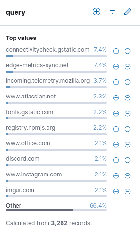
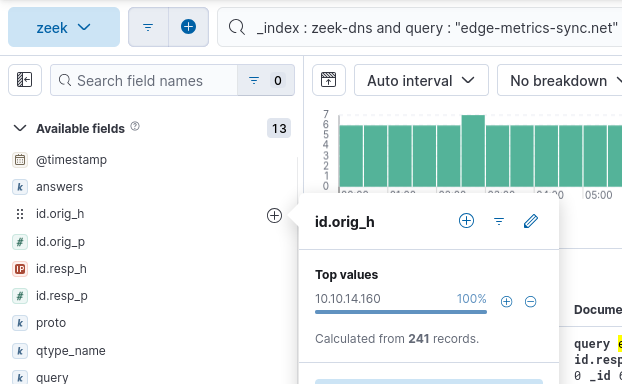
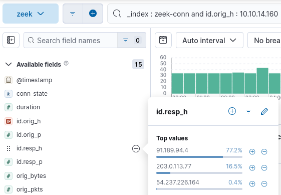
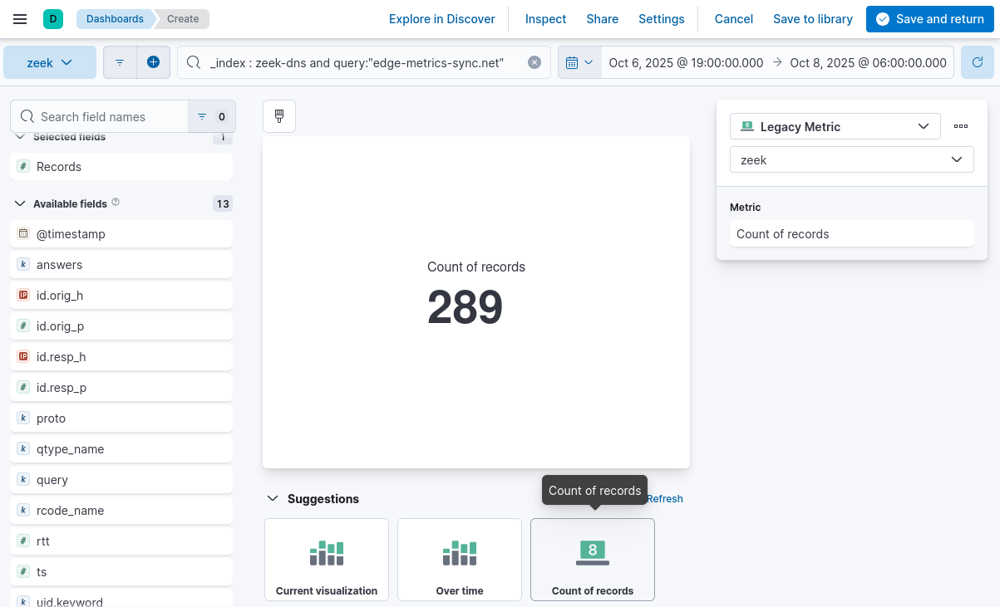
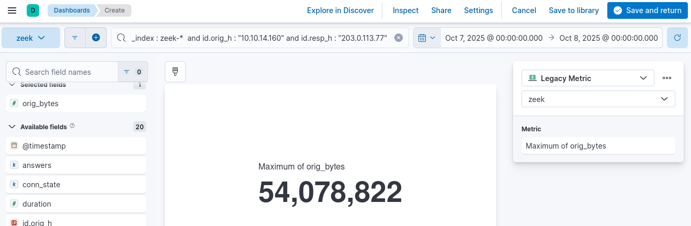

# Strange & Unusual Activity

|     Category    |Difficulty|
|:---------------:|:--------:|
|Network Forensics|  Medium  |

**Skills learned:**
* Practicing hypothesis-driven threat hunting to isolate C2 infrastructure and find a compromised host
* Leveraging Elastic Stack and Kibana interface to query and analyze large volumes of Zeek network telemetry
* Distinguishing malicious domains from normal network traffic to link internal IPs to external C2 servers
* Analyzing traffic between a compromised host and C2 server to determine adversary check-in patterns and quantifying outbound data transfers

## Mission
Something strange is happening on the corporate network, but the usual security tools have nothing to report. Investigate a day of network activity, follow the evidence, and uncover what slipped through unnoticed.
A threat-intelligence feed has flagged suspicious communications within the `10.10.14.0/24` corporate network. No security alerts were triggered, and the activity went unnoticed by internal monitoring.

With a full day of network logs at your disposal, investigate the traffic, identify the source of the suspicious communications, and determine what took place.

## Workspace
* Kibana web interface: **http://[LAB MACHINE IP]:5601**
* Data view: **zeek-\***
* Captured traffic: **07 October 2025 (24 hours)**

## Objectives
* Examine the network traffic for unusual communication patterns
* Distinguish suspicious activity from legitimate network services
* Identify the affected workstation and its external communications
* Investigate the volume of data transferred and determine the extent of the activity

## Analyst Note
Not every unusual connection is malicious, and not every malicious connection looks unusual on its own. Look at the bigger picture, compare the traffic, and let the evidence guide your investigation.

### Additional Setup and Lab Configuration Required
In order to connect to the lab machine, you'll need an *VPN configuration file* - I use OpenVPN. Find and edit your VPN settings under the [Manage account page](https://tryhackme.com/manage-account/access).

Additionally, I changed the time zone in the Kibana settings to **UTC** instead of **Browser** timezone. This setting can be found under *Kibana > Advanced Settings > General > Time zone*.

## Questions
**1. What is the domain name used by the command-and-control (C2) server?**

To find the domain name of the C2 server, we need to search through the *zeek-dns* logs, using the search query `_index: zeek-dns`.

We can look at the top values of the *query* field, which holds the actual domain name being looked up by the DNS query:



Based on this top-10 list alone, we can assume the domain *edge-metrics-sync.net* may be the C2 server, as the other domains in the list appear to be legitimate. However, we should investigate further.

We can look at the traffic pointed at each domain individually using the search query `_index : zeek-dns and query : "[DOMAIN NAME]"`.

Another suspicious finding is that searching for all traffic pointing to the domain *edge-metrics-sync.net* comes from the same IP address (10.10.14.160) which is in the *id.orig_h* field.



A full DNS query event to this domain is:
```
{
  "@timestamp": [
    "2025-10-07T23:59:53.919Z"
  ],
  "answers": [
    "203.0.113.77"
  ],
  "id.orig_h": [
    "10.10.14.160"
  ],
  "id.orig_p": [
    43200
  ],
  "id.resp_h": [
    "10.10.14.1"
  ],
  "id.resp_p": [
    53
  ],
  "proto": [
    "udp"
  ],
  "qtype_name": [
    "A"
  ],
  "query": [
    "edge-metrics-sync.net"
  ],
  "rcode_name": [
    "NOERROR"
  ],
  "rtt": [
    0.058006
  ],
  "ts": [
    1759881593.919443
  ],
  "uid": [
    "Cc417e7dd6b5f4e80"
  ],
  "uid.keyword": [
    "Cc417e7dd6b5f4e80"
  ],
  "_id": "6OOBNKEB0_csm3ucjExa",
  "_index": "zeek-dns",
  "_score": null
}
```

### Forming a Hypothesis Based on Observed Activity
Based on the timeline of events, it also seems that DNS queries to this domain happen on a regular basis. This could point to C2 beaconing, where a compromised host reaches out to the C2 server at regular time intervals.

We can form a hypothesis that this domain (edge-metrics-sync.net) is the C2 domain, the C2 server IP address is 203.0.113.77, and the compromised host is 10.10.14.160.

**Answer: edge-metrics-sync.net**

---

**2. What is the callback interval, in seconds, between the compromised host and the C2 server?**

Continuing to work with our hypothesis, we can calculate the callback interval based on the DNS queries to the *edge-metrics-sync.net* host. Using the search query `_index : zeek-dns and query: "edge-metrics-sync.net" and id.orig_h : 10.10.14.160` we can look at some of the timestamps and calculate the difference.

* Oct 7, 2025 @ 19:59:53.919
* Oct 7, 2025 @ 19:54:51.741
* Oct 7, 2025 @ 19:49:13.309

The average difference between timestamps is about *5 minutes and 2 seconds*, or **302** seconds. However, that is not exactly an even interval (100, 200, 300). Rounding down to the exactly *5 minutes (300 seconds)* gives us the callback interval.

**Answer: 300**

---

**3. What is the IP address of the compromised host?**

Based on our hypothesis, we can dig deeper into the traffic to/from host *10.10.14.160* to determine if we are proven right in thinking that this is the compromised host.

Using the search query `_index : zeek-conn and id.orig_h : 10.10.14.160`, we can see all traffic originating from host *10.10.14.160*.

We can look at the top values of the *id.resp_h* field, which holds the IP address of the responding host:



The assumed IP address of the C2 server (203.0.113.77) is this machine's second-most contacted remote host.

Pivoting to include the assumed C2 server IP to our search query: `_index : zeek-conn and id.orig_h : 10.10.14.160 and id.resp_h : 203.0.113.77` includes events such as this one:
```
{
  "_index": "zeek-conn",
  "_id": "yOOBNKEB0_csm3ucmWFn",
  "_version": 2,
  "_score": 0,
  "_source": {
    "id.orig_p": 49960,
    "resp_pkts": 1,
    "orig_bytes": 1466,
    "id.resp_p": 443
    "orig_pkts": 2,
    "duration": 0.110729,
    "uid": "Cba6e8d5e11964d83",
    "resp_bytes": 320,
    "@timestamp": "2025-10-07T23:59:53.979687+00:00",
    "service": "ssl",
    "conn_state": "SF",
    "proto": "tcp",
    "id.orig_h": "10.10.14.160",
    "ts": 1759881593.979687,
    "id.resp_h": "203.0.113.77"
  },
  "fields": {
    "uid.keyword": [
      "Cba6e8d5e11964d83"
    ],
    "id.orig_p": [
      49960
    ],
    "resp_pkts": [
      1
    ],
    "orig_bytes": [
      1466
    ],
    "id.resp_p": [
      443
    ],
    "orig_pkts": [
      2
    ],
    "duration": [
      0.110729
    ],
    "uid": [
      "Cba6e8d5e11964d83"
    ],
    "@timestamp": [
      "2025-10-07T23:59:53.979Z"
    ],
    "resp_bytes": [
      320
    ],
    "conn_state": [
      "SF"
    ],
    "service": [
      "ssl"
    ],
    "proto": [
      "tcp"
    ],
    "id.orig_h": [
      "10.10.14.160"
    ],
    "id.resp_h": [
      "203.0.113.77"
    ],
    "ts": [
      1759881593.979687
    ]
  }
}
```

From this log we can infer the following:
* The duration *0.110729* was very short. There was no persistent interactive session activity here.
* The assumed compromised host *10.10.14.160* sent another 1466 bytes to the assumed C2 server.
* The connection state *SF* indicates normal wstablishment and termination. The TCP handshake was successful, data was transferred and the connection closed gracefully.

These inferences further point to our hypothesis being correct.

**Answer: 10.10.14.160**

---

**4. How many check-ins (callbacks) did the compromised host make to the C2 domain over the capture window?**

I used a *visualization dashboard* here to find the total count of records between the compromised host and C2 server.

I set the starting and ending date to Oct 7, 2025 @ 00:00:00.0000 and Oct 8, 2025 @ 00:00:00.0000 based on the capture window we were provided *07 October 2025 (24 hours)* and used the search query `_index : zeek-dns and query:"edge-metrics-sync.net"`.

The dashboard used was **Count of records** and the result was *241*, which ended up being incorrect.

Expanding the start and end dates returned more records. The final time range I used that captured all callbacks between the compromised host and C2 server was: *Oct 6, 2025 @ 19:00:00.000 - Oct 8, 2025 @ 06:00:00.000*.



**Answer: 289**

---

**5. How many bytes of data were exfiltrated in the single largest outbound transfer to the C2 server?**

I utilized another *visualization dashboard* to answer this question. 

Using the search query `_index : zeek-*  and id.orig_h : "10.10.14.160" and id.resp_h : "203.0.113.77"` will search through *all* connections between the compromised host and C2 server.

We can take the log field **orig_bytes**, which represents the number payload of bytes sent by the source host, and use the *Maximum* function to the single log event with the maximum value of *orig_bytes*



The maximum value of the *orig_bytes* field is 54078822. Verifying that the *id.resp_h* field matches the C2 server IP address `203.0.113.77`, confirms that this is the single largest outbound transfer to the C2 server.

The full log for this event is:
```
{
  "_index": "zeek-conn",
  "_id": "O-OBNKEB0_csm3uclFpu",
  "_version": 2,
  "_score": 0,
  "_source": {
    "id.orig_p": 34913,
    "resp_pkts": 1,
    "orig_bytes": 54078822,
    "id.resp_p": 443,
    "orig_pkts": 108157,
    "duration": 75.227793,
    "uid": "C1671738666754672",
    "resp_bytes": 303,
    "@timestamp": "2025-10-07T15:27:53.766047+00:00",
    "service": "ssl",
    "conn_state": "SF",
    "proto": "tcp",
    "id.orig_h": "10.10.14.160",
    "ts": 1759850873.766047,
    "id.resp_h": "203.0.113.77"
  },
  "fields": {
    "uid.keyword": [
      "C1671738666754672"
    ],
    "id.orig_p": [
      34913
    ],
    "resp_pkts": [
      1
    ],
    "orig_bytes": [
      54078822
    ],
    "id.resp_p": [
      443
    ],
    "orig_pkts": [
      108157
    ],
    "duration": [
      75.227793
    ],
    "uid": [
      "C1671738666754672"
    ],
    "@timestamp": [
      "2025-10-07T15:27:53.766Z"
    ],
    "resp_bytes": [
      303
    ],
    "conn_state": [
      "SF"
    ],
    "service": [
      "ssl"
    ],
    "proto": [
      "tcp"
    ],
    "id.orig_h": [
      "10.10.14.160"
    ],
    "id.resp_h": [
      "203.0.113.77"
    ],
    "ts": [
      1759850873.766047
    ]
  }
}
```

**Answer: 54078822**

